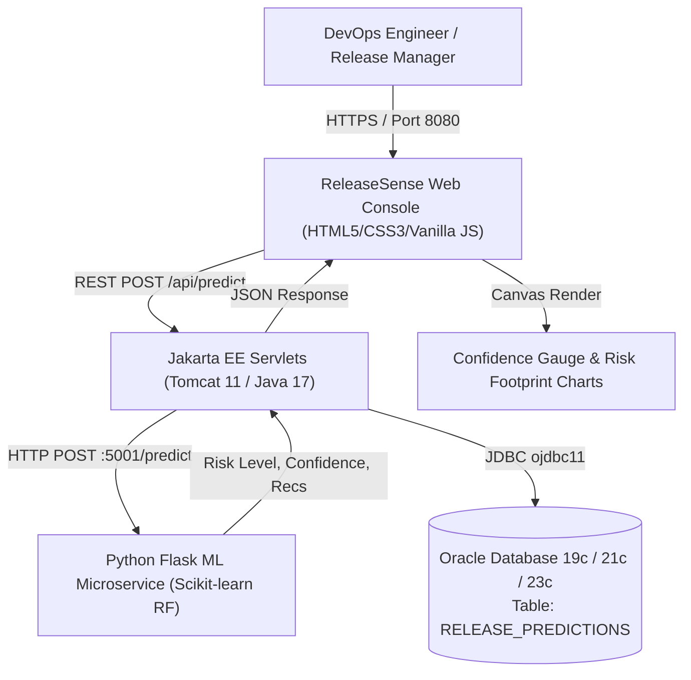

# ReleaseSense – Intelligent Release Prediction Platform

[](https://www.oracle.com/java/)
[](https://jakarta.ee/)
[](https://tomcat.apache.org/)
[](https://scikit-learn.org/)
[](https://www.docker.com/)
[](https://kubernetes.io/)

**ReleaseSense** is an enterprise-grade full-stack platform that analyzes software release telemetry and employs Machine Learning (Random Forest Classification) to predict software release risks before production deployment.

---

## 1. System Architecture



---

## 2. Technology Stack

| Layer | Technologies |
|---|---|
| **Frontend** | HTML5, Modern CSS (Responsive DevOps Dark Theme), Vanilla JavaScript (ES6+), HTML5 Canvas Charts |
| **Backend** | Java 17, Jakarta Servlet API 6.0, Apache Tomcat 11, Google Gson |
| **Build Tool** | Apache Maven 3.9+ |
| **Machine Learning** | Python 3.11+, Flask, Scikit-learn (Random Forest Classifier), Pandas, Joblib |
| **Database** | Oracle Database (12c/19c/21c/23c) via JDBC (`ojdbc11`), with local fallback engine |
| **Containerization** | Docker, Multi-stage builds, Docker Compose |
| **Orchestration** | Kubernetes, Minikube, NodePort & ClusterIP Services, Secrets |
| **CI/CD** | Jenkins Declarative Pipeline (`Jenkinsfile`) |

---

## 3. Project Directory Structure

```text
ReleaseSense/
├── .gitignore                     # Git ignore rules for Java, Python, Docker, IDEs
├── compose.yaml                   # Docker Compose multi-service definition
├── Dockerfile                     # Multi-stage Dockerfile for Tomcat 11 Java web application
├── Jenkinsfile                    # 8-stage Declarative CI/CD pipeline
├── pom.xml                        # Maven project descriptor (Java 17, Jakarta EE 10, ojdbc11)
├── README.md                      # Comprehensive project documentation
├── k8s/                           # Kubernetes manifests for Minikube deployment
│   ├── ml-deployment.yaml         # Python ML microservice Deployment (2 replicas)
│   ├── oracle-secret.yaml         # Oracle DB credential secret
│   ├── services.yaml              # NodePort (30080) for Web, ClusterIP (5001) for ML
│   └── web-deployment.yaml        # Java Tomcat application Deployment
├── ml-service/                    # Machine Learning microservice
│   ├── data/
│   │   └── release_metrics.csv    # Historical release metrics training dataset
│   ├── models/
│   │   ├── model_metadata.json    # Model evaluation metrics and feature importances
│   │   └── release_risk_rf.joblib # Persisted trained Random Forest classifier
│   ├── app.py                     # Flask REST API (:5001) with /health, /metadata, /predict
│   ├── Dockerfile                 # Container definition for Python ML microservice
│   ├── generate_dataset.py        # Realistic synthetic dataset generator
│   ├── requirements.txt           # Python library dependencies
│   ├── test_api.py                # Automated unit & integration tests for ML API
│   └── train_model.py             # Random Forest training & evaluation pipeline
├── scripts/
│   └── schema.sql                 # Oracle DDL & DML (RELEASE_PREDICTIONS table, indexes, seeds)
└── src/
    ├── main/
    │   ├── java/com/releasesense/
    │   │   ├── dao/
    │   │   │   ├── DatabaseConfig.java      # JDBC connection factory with env var support
    │   │   │   └── ReleasePredictionDAO.java# JDBC CRUD operations for predictions
    │   │   ├── model/
    │   │   │   ├── PredictionResult.java    # Prediction outcome & persistence model
    │   │   │   └── ReleaseMetric.java       # Input metrics model with strict validation
    │   │   ├── service/
    │   │   │   └── MLPredictionService.java # HTTP client for Python ML API with heuristic fallback
    │   │   └── servlet/
    │   │       ├── HealthServlet.java       # GET /api/health (Database & ML status)
    │   │       ├── HistoryServlet.java      # GET /api/history (Past predictions & KPIs)
    │   │       └── PredictServlet.java      # POST /api/predict (Inference & persistence)
    │   └── webapp/
    │       ├── css/
    │       │   └── styles.css               # Modern DevOps console styling
    │       ├── js/
    │       │   └── app.js                   # Interactive controller, validation & canvas rendering
    │       ├── WEB-INF/
    │       │   └── web.xml                  # Jakarta Servlet 6.0 deployment descriptor
    │       └── index.html                   # 8-section responsive dashboard
    └── test/java/com/releasesense/
        ├── MLPredictionServiceTest.java     # Unit tests for ML prediction client & fallback
        ├── ReleaseMetricTest.java           # Unit tests for input boundary validation
        └── ReleasePredictionDAOTest.java    # Unit tests for database operations
```

---

## 4. Machine Learning Model & Pipeline

### Features
The Random Forest model consumes five release features:
1. `changed_files` (*int*): Number of modified, added, or deleted files.
2. `failed_tests` (*int*): Number of failed test cases in build pipeline.
3. `critical_bugs` (*int*): Number of open P0/P1 defects associated with release.
4. `coverage` (*float*): Unit & integration test code coverage percentage (0.0 – 100.0%).
5. `previous_failure_rate` (*float*): Historical deployment failure percentage (0.0 – 100.0%).

### Dataset Transparency
> [!NOTE]
> The historical training data (`ml-service/data/release_metrics.csv`) is synthetic demonstration data engineered to reflect realistic enterprise DevOps failure dynamics (e.g., test failures, coverage dips, and bug densities). Model accuracy benchmarked on this dataset is **99.17%**. For enterprise production use, retrain with your organization's historical release logs.

---

## 5. Local Setup & Execution Guide

### Prerequisites
- Java JDK 17 or later (verified with JDK 26)
- Apache Maven 3.9+
- Python 3.11+
- Git

### Step 1: Run the Machine Learning Microservice
Open PowerShell:
```powershell
cd C:\Users\raksh\.gemini\antigravity\scratch\ReleaseSense\ml-service

# Create virtual environment & install dependencies
python -m venv venv
.\venv\Scripts\activate
pip install -r requirements.txt

# Train model & run unit tests
python train_model.py
python test_api.py

# Start Flask ML REST API on port 5001
python app.py
```
ML API will be live at `http://localhost:5001/health`.

### Step 2: Build & Test Java Backend
Open a second PowerShell window:
```powershell
cd C:\Users\raksh\.gemini\antigravity\scratch\ReleaseSense

# Execute test suite
mvn clean test

# Package WAR distribution
mvn package -DskipTests
```
The deployable archive will be generated at `target/releasesense.war`.

### Step 3: Deploy to Apache Tomcat 11
Copy `target/releasesense.war` to your Tomcat 11 `webapps/` folder as `ROOT.war` (or `releasesense.war`).
Start Tomcat:
```powershell
# In Tomcat bin folder:
catalina.bat run
```
Open your browser at: **`http://localhost:8080/`**

---

## 6. Oracle Database Configuration

ReleaseSense connects to Oracle Database using official Oracle JDBC drivers (`ojdbc11`).
Set the following environment variables:

```powershell
# Windows PowerShell
$env:ORACLE_DB_URL = "jdbc:oracle:thin:@//localhost:1521/FREE"
$env:ORACLE_DB_USER = "releasesense"
$env:ORACLE_DB_PASSWORD = "YourSecurePassword"
```

Execute the database schema setup:
```sql
-- In SQL Developer or SQL*Plus:
@scripts/schema.sql
```

> [!TIP]
> **Zero-Friction Local Development**: If Oracle Database is not locally running, ReleaseSense automatically starts in **Local Oracle-Compatible Mode** so you can develop, test, and demo all features without errors.

---

## 7. Running with Docker & Docker Compose

Run both services seamlessly with a single command:

```powershell
cd C:\Users\raksh\.gemini\antigravity\scratch\ReleaseSense

# Build and start services
docker compose up --build
```

Access the application:
- Web Dashboard: `http://localhost:8080`
- Python ML Service: `http://localhost:5001/health`

To also run a containerized Oracle Database 23c Free instance:
```powershell
docker compose --profile with-oracle up --build
```

---

## 8. Kubernetes Deployment (Minikube)

Deploy ReleaseSense on local Minikube:

```powershell
# 1. Start Minikube
minikube start

# 2. Point Docker CLI to Minikube Docker daemon
& minikube -p minikube docker-env --shell powershell | Invoke-Expression

# 3. Build container images inside Minikube
docker build -t releasesense-ml:latest ./ml-service
docker build -t releasesense-web:latest .

# 4. Apply Kubernetes manifests
kubectl apply -f k8s/oracle-secret.yaml
kubectl apply -f k8s/ml-deployment.yaml
kubectl apply -f k8s/web-deployment.yaml
kubectl apply -f k8s/services.yaml

# 5. Check deployment status
kubectl get pods
kubectl get services

# 6. Access the Dashboard
minikube service releasesense-web-service
# Or open http://<minikube-ip>:30080
```

---

## 9. Jenkins CI/CD Pipeline

The included `Jenkinsfile` defines an end-to-end automated pipeline:
1. **Checkout SCM**: Clones the GitHub repository.
2. **Python Setup**: Sets up virtual environment and installs dependencies.
3. **Train & Evaluate ML Model**: Re-trains Random Forest and verifies model benchmarks.
4. **Java Maven Build & Test**: Compiles Java 17 Servlets and runs JUnit test suite.
5. **Package WAR**: Assembles the Tomcat 11 web archive.
6. **Docker Image Creation**: Builds container images for both services.
7. **Publish Docker Images**: Pushes images to Docker Hub or private registry with build number tags.
8. **Kubernetes Deployment**: Applies updated manifests and monitors rolling update.

---

## 10. Git Initialization & GitHub Push Instructions

Initialize and push to your GitHub repository:

```powershell
cd C:\Users\raksh\.gemini\antigravity\scratch\ReleaseSense

# Initialize Git repository
git init

# Add all files (respecting .gitignore)
git add .

# Create initial commit
git commit -m "feat: Initial commit for ReleaseSense Intelligent Release Prediction Platform"

# Link to your remote GitHub repository
git branch -M main
git remote add origin https://github.com/<your-username>/ReleaseSense.git

# Push to GitHub
git push -u origin main
```
